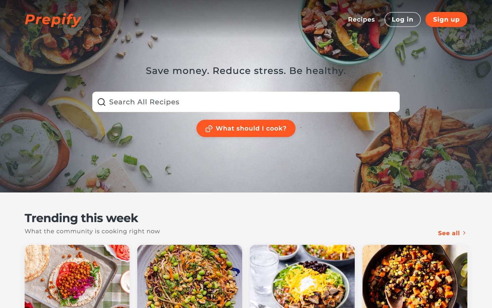
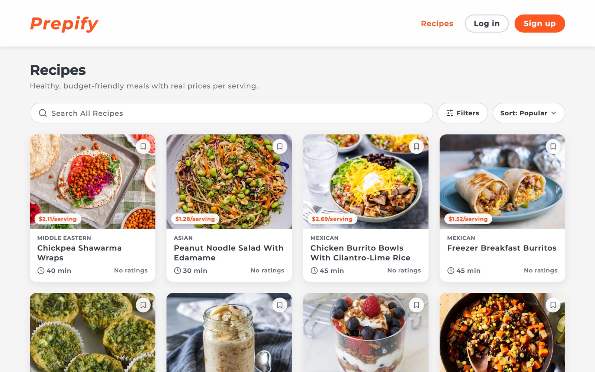
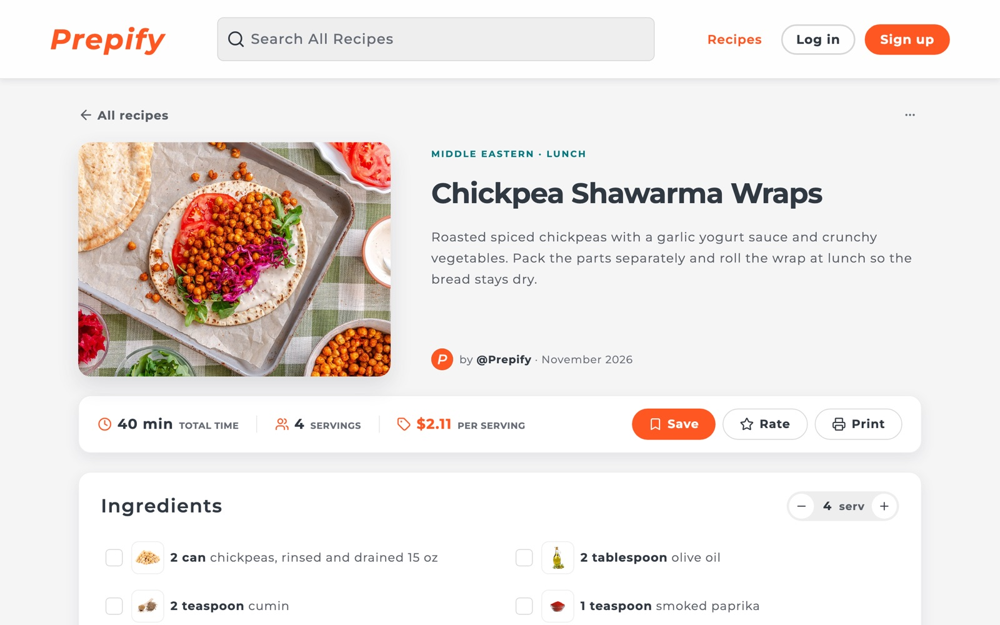

# Prepify

A recipe site for meal prep that tells you what each serving costs.

**Live at [prepifymeals.com](https://prepifymeals.com)**



Every recipe on Prepify shows a price per serving, worked out from its ingredient list. Type "2 cans chickpeas, rinsed and drained" and the site parses the quantity, unit, and ingredient, looks up a price and an image, and adds it to the recipe's total. Change the servings and the quantities scale with it.

I built it alone: the React frontend, the Express API, the deploy setup on Netlify and Railway, and the ingredient parser it depends on, which I publish to npm separately.

| Browse and filter | A recipe page |
| --- | --- |
|  |  |

## What it does

- Prices each ingredient and the whole recipe per serving. If the parser can't price a row, the author can enter a price, and the site warns before publishing a recipe with unpriced rows.
- Nutrition facts for each recipe, from the Edamam API through the server.
- Search with autocomplete, filters for cuisine, meal type, and diet, and sorting by popularity, date, price, or cooking time. A "What should I cook?" button on the home page suggests a recipe.
- Accounts with Firebase Auth: save recipes into collections, rate and review them, keep drafts, and earn achievements. Each user has a public profile.
- Moderation runs on every write. Text goes through a blocklist and OpenAI's moderation API, images through Google Cloud Vision, and users can report recipes and other users. Admins get a dashboard for reports, users, and recipes.
- Responsive images: a Firebase extension resizes each upload, and the pages serve the right size with `srcset`.

## How it's built

```
Browser ──► prepifymeals.com (Netlify)
              ├── React SPA (Vite, TypeScript, SCSS)
              └── /api/*  ──► Netlify Edge Function ──► Express API (Railway)
                                                          ├── MongoDB Atlas
                                                          ├── Firebase Admin (auth, storage)
                                                          ├── ingredient proxy ──► Spoonacular
                                                          └── Edamam, OpenAI, Cloud Vision
```

- **Frontend.** React 19 and TypeScript, built with Vite. TanStack Query handles server state, React Router handles routes, and Firebase's client SDK handles sign-in. An axios interceptor attaches the user's Firebase ID token to every API call.
- **API.** Express on Node 24, deployed to Railway from the `release` branch. Middleware verifies the Firebase token, rate-limits each route, and caps daily calls to the paid APIs per user and in total, so a burst of new accounts can't run up a bill.
- **Same-origin API calls.** Some networks' DNS blocks `*.railway.app`, which left those visitors looking at an empty site. Now the browser only calls `prepifymeals.com/api/*`, and a Netlify Edge Function forwards the request to Railway. The function passes the visitor's real IP along with a shared secret, so the server's per-IP rate limits still work.
- **Data.** MongoDB Atlas for recipes, reviews, users, and collections. Firebase Storage for images.
- **Monitoring.** Sentry on both the client and the server, tagged with the same release version so a frontend error can be matched to the backend deploy. `GET /health` runs a real database query, and `GET /version` reports the deployed commit.

## The ingredient parser

Pricing depends on [`@jclind/ingredient-parser`](https://github.com/jclind/ingredient-parser) ([npm](https://www.npmjs.com/package/@jclind/ingredient-parser)), which I wrote for this project.

It works in two halves:

1. **Parsing runs in the browser, with no network call.** "1 1/2 cups flour, sifted" becomes a quantity of 1.5, a unit of cups, the ingredient "flour", and the comment "sifted". The new row appears in the recipe form right away.
2. **Enrichment runs on the server.** Prepify's API calls the package's hosted proxy, which holds the Spoonacular API key and caches lookups, so the key never ships to the browser. The proxy returns a price and an image, and the row fills in. To price a volume like "2 cups" from a per-gram price, the parser converts with a density table, and it declines to guess when it has no density for that ingredient.

The server maps the package's result onto Prepify's own stored shape, so a new parser version doesn't change saved recipes.

## Testing

- 108 Vitest files for the frontend (jsdom and Testing Library)
- 48 Jest and Supertest files for the API, against an in-memory MongoDB
- 6 Cypress end-to-end specs

GitHub Actions runs all three, plus a typecheck and a production build, on every pull request.

## Running it locally

You need Node 24, a MongoDB database, and a Firebase project.

```bash
git clone https://github.com/jclind/prepify.git
cd prepify
npm install
npm install --prefix server

cp .env.example .env               # Firebase web config, VITE_API_URL
cp server/.env.example server/.env # MONGO_URI, FIREBASE_SERVICE_ACCOUNT, API keys

npm run dev --prefix server        # API on http://localhost:4000
npm start                          # site on http://localhost:3000
```

`npm test` runs the frontend tests, `npm run test:server` the API tests, and `npm run test:e2e` the Cypress specs. `CLAUDE.md` lists every environment variable.
